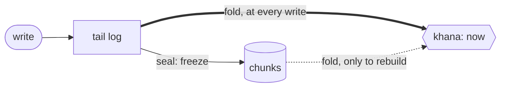

# hosigraph ⭐

[](https://github.com/sukhi-social/hosigraph/actions/workflows/test.yml)

A small embedded database that **keeps the past as events**, and keeps **"now" as a copy you can put down**.

> [!NOTE]
> A prototype, written in Haskell. **S3 is not here yet.** Come and sit with it for a while; if anything puzzles you, an issue is welcome.

## The idea

1. Every change is an **event**: a `Create` or a `Delete` of one fact. Events are only added, never edited. **The events are the truth.**
2. **"Now"** is a Datalog database called the **khana**, built by folding the events. Lose it, or stop trusting it? Throw it away; the events build it again.
3. So there are two ways to read:

| You ask about | You get it from | Call |
|---|---|---|
| **now** | the khana | `getEntity`, `query` |
| **the past** | the events of one ID | `history` |



* **Every day** (thick arrow): a write goes into the tail log and is folded into the khana at once.
* **`seal`** (thin arrow): the tail log is frozen into chunks. The khana is not touched.
* **Rebuild** (dotted arrow): only when the khana is lost or doubted (`rebuildKhana`). It folds the chunks, then the tail log, into a fresh khana.

The first goal was small, and we kept it small: **write, seal, restart, and get the same answers.**
The tests stop the system in five places and check what comes back.

## A taste

```haskell
main = bracket (openHosiWith cfg "/tmp/hosi" schema) closeHosi $ \h -> do
  r <- write h [ Create (Tmp 1) "person/name" (Lit (VStr "Frege"))      -- Tmp 1 becomes a real ID
               , Create (Tmp 1) "person/age"  (Lit (VInt 70)) ]
  let frege = wrTemps r M.! 1
  getEntity h frege >>= print                                     -- now
  query h "[:find ?n :where [?e :person/name ?n]]" [] >>= print   -- Datalog, as Datalevin reads it
  _ <- seal h                                                     -- freeze the tail log into chunks
  history h frege >>= mapM_ print                                 -- the past
```

A write goes in whole, or not at all. `verify` rebuilds a khana from the events and checks that it equals yours.

<details>
<summary><b>How does it ask the past without waking everything?</b></summary>

<br>

A question about one ID goes through gates, the cheapest first:

1. the **zone map** in the manifest (month, ID range): no file is touched;
2. the chunk's **Binary Fuse filter**: a few bytes per ID. "Certainly not" is always right; "maybe" is wrong about once in 65,536;
3. only for a "maybe", the chunk is opened and the slot is found.

A chunk that the filter turns away is **never opened**. A test checks this.

</details>

## Running it

```sh
cabal build all
cabal test
cabal run hosigraph-demo
```

Tested with GHC 9.10.3 on macOS arm64.

> [!TIP]
> "Now" lives in [Datalevin](https://github.com/datalevin/datalevin). Bring either the `dtlv` executable, or JDK 21 and the standalone jar.
> Without them the tests still run, and print which parts they skipped. How to point hosigraph at Datalevin: [the long guide](docs/guide.md).

## Where it is

- [x] Phase 1: events, chunks, the khana, restart-safe
- [x] Phase 2, first half: the filter, and reading a chunk by ranges
- [x] A C interface, `libhosi`, written by [setu](docs/guide.md#from-other-languages-setu-hosigraph-abi) (seen working on macOS only)
- [x] Phase 3, the local part: `erase` (ids, a span of ids or time, or what an account owns), `clean`, `freeze` (cold chunks), also through the C door
- [ ] S3 ([plan](TODO.md))

Speed is only roughly measured, and the guide lists the limits.

## More

- [The long guide](docs/guide.md): Datalevin setup, file layout, limits, and what the names mean
- [The design this grew from](docs/hosiDB-design-v0.2.0-draft.md) (it was called hosiDB then) and [design notes](docs/design-notes.md)
- [takka](takka/README.md): the small library of words hosigraph and Datalevin share

*P.S.* `Hosi` + `Khana` sounds like *hoshi kana*: "is it a star?"

## License

[Blue Oak Model License 1.0.0](LICENSE): short, plain English. Do what you like, and pass the licence (or its link) on with it.
What hosigraph stands on is in [`docs/dependency-licenses.md`](docs/dependency-licenses.md). Datalevin is a separate program with its own licence; hosigraph only talks to it.
